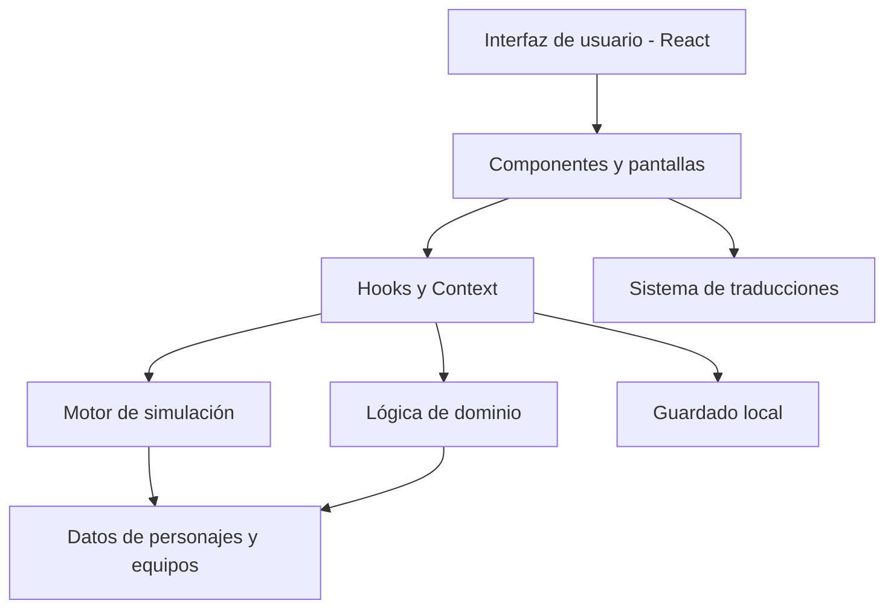

# ⚡ FF Manager – Juego Web de Gestión Futbolística

**FF Manager (Fútbol Frontier Manager)** es un videojuego web gratuito de gestión futbolística inspirado en el universo de *Inazuma Eleven*.

El proyecto permite asumir el papel de entrenador y director de un club, gestionar una plantilla de personajes, realizar fichajes, entrenar jugadores, configurar tácticas y competir en partidos con supertécnicas.

### 🎮 [¡Haz clic aquí para jugar gratis a FF Manager!](https://playffmanager.com/)

Juega directamente desde tu navegador, sin instalaciones ni registro.

> 💾 **Importante sobre las partidas:** el progreso se guarda localmente en el navegador y dispositivo donde juegas. No se sincroniza automáticamente entre navegadores o dispositivos.
>
> Para conservar tu progreso o trasladarlo a otro dispositivo, utiliza las opciones **Exportar partida** e **Importar partida** del juego. Te recomendamos hacer copias de seguridad, ya que borrar los datos del sitio o utilizar el modo incógnito puede provocar la pérdida del progreso.

---

## 🎯 Propósito del Proyecto

El objetivo de FF Manager es combinar la gestión de un club de fútbol con las características de *Inazuma Eleven*, ofreciendo una experiencia donde las decisiones del jugador influyen en la evolución del equipo.

El proyecto se centra en tres aspectos:

- **Gestión deportiva:** fichajes, economía, plantillas, alineaciones y tácticas.
- **Progresión:** entrenamiento, mejora de jugadores, competiciones y desarrollo del club.
- **Simulación:** partidos con estadísticas, elementos, supertécnicas y decisiones estratégicas.

FF Manager es un proyecto personal en desarrollo continuo.

## ⚽ Funcionalidades Principales

### 👥 Gestión de plantillas

- Catálogo de **5.130 personajes**.
- Más de **195 equipos**.
- Búsqueda y filtrado de jugadores.
- Mercado de fichajes y gestión del presupuesto.
- Organización del once inicial.
- Configuración de formaciones y posiciones.
- Comparación de estadísticas y valoración de jugadores.

### 🏋️ Entrenamiento y progresión

- Entrenamiento y mejora de atributos.
- Gestión de energía y recuperación.
- Progresión de nivel.
- Mejoras de las instalaciones del club.

### 🧠 Tácticas y estrategia

- Selección de formaciones.
- Mentalidad ofensiva o defensiva.
- Configuración de presión, ritmo y pases.
- Familiaridad táctica.
- Preparación del equipo antes de los encuentros.

### ⚡ Simulador de partidos

- Simulación de encuentros de fútbol.
- Estadísticas individuales y de equipo.
- Duelos con porcentajes de éxito.
- Supertécnicas de tiro, regate, defensa y portero.
- Afinidades elementales.
- Gestión de PE y PT.
- Retransmisión de acciones y estadísticas.
- Visualización táctica del campo.

El motor de partidos continúa evolucionando para mejorar el posicionamiento, la coherencia de las jugadas y el equilibrio de los resultados.

### 🏆 Modos de juego

**📖 Modo Historia**

Campaña narrativa compuesta por seis rutas o capítulos, con partidos y rivales inspirados en el universo de *Inazuma Eleven*.

**🏅 Modo Carrera**

Modo orientado a la gestión de un club, la evolución de su plantilla y la competición en un sistema de cinco divisiones.

### 🌍 Internacionalización

La interfaz está disponible en:

- 🇪🇸 Español
- 🇬🇧 Inglés
- 🇯🇵 Japonés

---

## 📐 Arquitectura del Sistema

FF Manager utiliza una arquitectura basada en componentes, separando la interfaz, la gestión del estado, la lógica del juego y los datos.

Esta organización facilita el mantenimiento y la evolución de las mecánicas sin concentrar toda la lógica en los componentes visuales.

## 💻 Implementación Técnica

### 🎨 Interfaz de Usuario

- **React 19:** construcción de pantallas y componentes reutilizables.
- **TypeScript:** tipado estático y organización del código.
- **Tailwind CSS v4:** diseño responsive y sistema de estilos.
- **Inter y Rajdhani:** tipografías de la interfaz.
- **Lucide React:** iconografía.

### ⚙️ Lógica y Simulación

- Motor del juego desarrollado en TypeScript.
- Cálculo de atributos, estadísticas y bonificaciones.
- Sistemas de economía, entrenamiento y progresión.
- Gestión de formaciones, tácticas y alineaciones.
- Resolución de acciones y duelos durante los partidos.

### 💾 Persistencia

El progreso se almacena localmente en el navegador mediante `localStorage`.

El juego permite **exportar e importar partidas**, facilitando la conservación y transferencia manual del progreso.

No requiere crear una cuenta.

### 🧪 Calidad y Herramientas

- **Vitest:** pruebas automatizadas.
- **TypeScript:** comprobación de tipos.
- **oxlint:** análisis estático.
- **Git y GitHub:** control de versiones.
- **Vite:** desarrollo y compilación.

## 🛠️ Stack Tecnológico

| Categoría | Herramientas / Tecnologías |
|-----------|-----------------------------|
| Lenguaje | TypeScript |
| Frontend | React 19 |
| Build Tool | Vite |
| Estilos | Tailwind CSS v4 |
| Iconografía | Lucide React, Bootstrap Icons |
| Tipografías | Inter, Rajdhani |
| Estado | React Hooks y Context |
| Persistencia | localStorage |
| Internacionalización | Sistema i18n propio |
| Testing | Vitest |
| Calidad | TypeScript, oxlint |
| Control de versiones | Git, GitHub |
| Plataforma | Navegador web |

---

## 📸 Galería del Juego

Capturas de las diferentes pantallas y funcionalidades de FF Manager.

<table align="center">
  <tr>
    <td align="center">
       
      Menú principal
    </td>
    <td align="center">
       
      Gestión de plantilla
    </td>
  </tr>
  <tr>
    <td align="center">
       
      Mercado de fichajes
    </td>
    <td align="center">
       
      Simulador de partidos
    </td>
  </tr>
  <tr>
    <td align="center">
       
      Tácticas
    </td>
    <td align="center">
       
      Entrenamiento
    </td>
  </tr>
</table>

> **Nota:** sustituye las rutas anteriores por las capturas reales del juego antes de publicar.

---

## 🚀 Cómo Jugar

1. Accede a **[playffmanager.com](https://playffmanager.com/)**.
2. Selecciona el Modo Historia o el Modo Carrera.
3. Crea tu equipo.
4. Gestiona jugadores, fichajes y presupuesto.
5. Configura tu alineación y tácticas.
6. Entrena y mejora la plantilla.
7. Compite en partidos y progresa.

## 🔄 Estado del Proyecto

FF Manager es un proyecto personal publicado y en desarrollo activo.

Actualmente se trabaja en mejorar la experiencia de usuario y perfeccionar los sistemas de simulación, economía, entrenamiento y equilibrio.

---

## ⚖️ Aviso Legal

**FF Manager es un proyecto fan-made, gratuito y no oficial**, inspirado en *Inazuma Eleven*.

No está afiliado, patrocinado ni respaldado por **LEVEL-5** ni por los titulares de las marcas y personajes originales.

*Inazuma Eleven*, sus personajes y demás elementos protegidos pertenecen a sus respectivos titulares.

---

## 👤 Contacto

  
  
  

