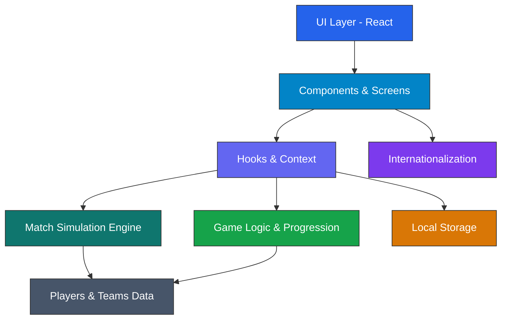

# ⚡ FF Manager – Juego Web de Gestión Futbolística

**FF Manager (Fútbol Frontier Manager)** es un videojuego web gratuito de gestión futbolística inspirado en el universo de *Inazuma Eleven*. Permite gestionar un club, fichar personajes, entrenar jugadores, configurar alineaciones y tácticas, y competir en partidos donde las estadísticas y las supertécnicas influyen en el resultado.

### 🎮 [¡Haz clic aquí para jugar gratis a FF Manager!](https://playffmanager.com/)

**Juega directamente desde el navegador, sin instalaciones ni registro.**

> 💾 **Guardado de partidas:** el progreso se almacena localmente en el navegador y dispositivo utilizado. No se sincroniza automáticamente entre dispositivos. Para conservarlo o trasladarlo, utiliza las opciones **Exportar partida** e **Importar partida**. Se recomienda realizar copias de seguridad antes de borrar los datos del navegador.

---

## 🎯 Propósito del Proyecto

El objetivo de FF Manager es combinar la gestión estratégica de un equipo de fútbol con los personajes y las mecánicas características de *Inazuma Eleven*, ofreciendo una experiencia centrada en la planificación, la progresión y la toma de decisiones.

El proyecto se desarrolla alrededor de tres pilares:

* **Gestión Deportiva:** administración de plantillas, mercado de fichajes, economía del club y organización del once titular.
* **Entrenamiento y Estrategia:** mejora de atributos, gestión de energía, selección de formaciones y configuración de tácticas.
* **Simulación de Partidos:** encuentros con estadísticas individuales, duelos, afinidades elementales y supertécnicas.

## ⚽ Funcionalidades Principales

### 👥 Gestión de Plantillas

* Catálogo de **5.130 personajes** y **195 equipos**.
* Mercado de fichajes con búsqueda y filtros.
* Gestión del presupuesto y los recursos del club.
* Organización de alineaciones y posiciones.
* Comparación de estadísticas, niveles y valoraciones.

### 🏋️ Entrenamiento y Progresión

* Entrenamiento para mejorar los atributos de los jugadores.
* Sistema de niveles y evolución de la plantilla.
* Gestión de energía, descanso y recuperación.
* Mejoras de las instalaciones del club.

### 🧠 Tácticas y Simulación

* Diferentes formaciones y estilos de juego.
* Configuración de mentalidad, presión, ritmo y pases.
* Partidos con duelos y probabilidades de éxito.
* Supertécnicas de tiro, regate, defensa y portero.
* Afinidades elementales y consumo de PE y PT.
* Retransmisión de jugadas y visualización táctica 2D.

### 🏆 Modos de Juego

* **Modo Historia:** campaña narrativa organizada en seis capítulos, con partidos y rivales inspirados en *Inazuma Eleven*.
* **Modo Carrera:** gestión del club a largo plazo y competición en un sistema de cinco divisiones.

El juego dispone de interfaz en **español, inglés y japonés**.

---

## 📐 Arquitectura del Sistema

FF Manager utiliza una arquitectura modular que separa la interfaz de usuario, la gestión del estado y las reglas del juego. El motor de simulación y los sistemas de dominio están desarrollados en TypeScript, mientras que React se encarga de la presentación e interacción.

Esta separación permite mantener las mecánicas de gestión y simulación independientes de los componentes visuales, facilitando las pruebas y la evolución del proyecto.

## 💻 Implementación Técnica

### ⚙️ Lógica de Juego (Game Engine)

* **TypeScript:** implementación de las reglas del juego, cálculos de atributos, estadísticas y bonificaciones.
* **Simulación de Partidos:** resolución de acciones, duelos, supertécnicas y resultados.
* **Gestión Deportiva:** sistemas de fichajes, economía, entrenamiento, tácticas y progresión.
* **Vitest:** pruebas automatizadas para comprobar las reglas y prevenir regresiones.

### 🎨 Interfaz de Usuario (UI Layer)

* **React 19:** construcción de pantallas y componentes reutilizables.
* **Tailwind CSS v4:** diseño responsive y sistema visual consistente.
* **React Hooks & Context:** gestión y distribución del estado de la aplicación.
* **Lucide React y Bootstrap Icons:** iconografía de la interfaz.
* **Inter y Rajdhani:** tipografías utilizadas en el diseño.

### 💾 Persistencia e Internacionalización

* **localStorage:** almacenamiento local del progreso sin necesidad de cuentas de usuario.
* **Exportación e Importación:** herramientas para realizar copias de seguridad y trasladar partidas.
* **Sistema i18n:** traducciones de la interfaz a español, inglés y japonés.

## 🛠️ Stack Tecnológico

| Categoría | Herramientas / Tecnologías |
|-----------|-----------------------------|
| **Lenguaje** | TypeScript |
| **Frontend** | React 19 |
| **Build Tool** | Vite |
| **Estilos** | Tailwind CSS v4 |
| **Estado** | React Hooks, Context |
| **Persistencia** | localStorage |
| **Internacionalización** | Sistema i18n propio |
| **Testing** | Vitest |
| **Calidad de código** | TypeScript, oxlint |
| **Iconografía** | Lucide React, Bootstrap Icons |
| **Herramientas** | Git, GitHub |

## 📸 Galería del Juego

A continuación se muestran las principales pantallas de FF Manager, desde la gestión de la plantilla hasta la simulación de partidos.

<!--
Sustituye las rutas por capturas reales del juego antes de publicar.

Las imágenes pueden colocarse en docs/screenshots/
o utilizar enlaces de GitHub user-attachments.
-->

<table align="center">
  <tr>
    <td valign="top" align="center">
       
      Menú principal
    </td>
    <td valign="top" align="center">
       
      Gestión de plantilla
    </td>
  </tr>
  <tr>
    <td valign="top" align="center">
       
      Mercado de fichajes
    </td>
    <td valign="top" align="center">
       
      Alineaciones y tácticas
    </td>
  </tr>
  <tr>
    <td valign="top" align="center">
       
      Entrenamiento
    </td>
    <td valign="top" align="center">
       
      Simulador de partidos
    </td>
  </tr>
</table>

---

## 🔄 Estado del Proyecto

FF Manager está **publicado y en desarrollo activo**.

Actualmente se trabaja en ampliar las funcionalidades, mejorar el equilibrio del juego y perfeccionar el simulador de partidos para ofrecer encuentros más coherentes y estratégicos.

## ⚖️ Aviso Legal

**FF Manager es un proyecto fan-made, gratuito y no oficial**, inspirado en *Inazuma Eleven*.

No está afiliado, patrocinado ni respaldado por **LEVEL-5** ni por los titulares de la franquicia.

*Inazuma Eleven*, sus personajes, nombres, imágenes y demás elementos protegidos pertenecen a sus respectivos titulares.

---

## 👤 Contacto

  
  
  

