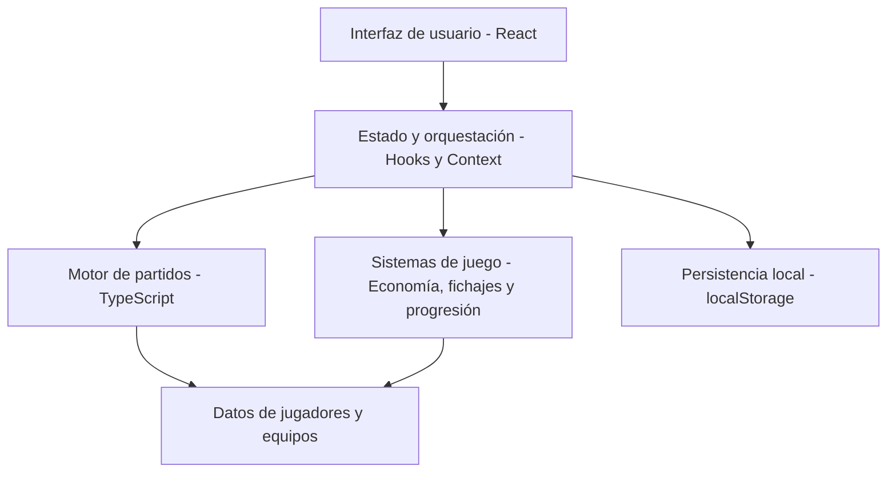

# ⚡ FF Manager — Juego de Gestión Futbolística

**FF Manager (Fútbol Frontier Manager)** es un videojuego web gratuito de gestión futbolística inspirado en el universo de *Inazuma Eleven*.

Conviértete en entrenador de tu propio equipo, ficha a tus personajes favoritos, desarrolla sus habilidades, prepara alineaciones y tácticas, y compite en partidos donde las estadísticas, las decisiones y las supertécnicas tienen un papel fundamental.

### 🎮 [¡Haz clic aquí para jugar gratis a FF Manager!](https://playffmanager.com/)

**Disponible directamente desde el navegador, sin instalaciones ni necesidad de registrarse.**

> 💾 **Importante:** las partidas se guardan localmente en el navegador y dispositivo utilizado. El progreso no se sincroniza automáticamente entre dispositivos. Para conservarlo o trasladarlo, utiliza las opciones **Exportar partida** e **Importar partida**. Se recomienda realizar copias de seguridad antes de borrar los datos del navegador.

---

## 🎯 Sobre el Proyecto

FF Manager nace como un proyecto personal con el objetivo de combinar la gestión estratégica de un club de fútbol con los personajes y las mecánicas características de *Inazuma Eleven*.

El jugador debe tomar decisiones sobre su plantilla, gestionar los recursos disponibles y preparar al equipo para superar diferentes competiciones.

El proyecto está en desarrollo activo, incorporando mejoras en la experiencia de usuario, la progresión y el sistema de simulación de partidos.

## ⚽ Características del Juego

### 👥 Fichajes y gestión de plantilla

- Catálogo de **5.130 personajes** y **195 equipos**.
- Mercado de fichajes con búsqueda y filtros.
- Gestión del presupuesto y la economía del club.
- Organización de la plantilla y del once titular.
- Comparación de estadísticas, niveles y posiciones.

### 🏋️ Entrenamiento y progresión

- Entrenamiento para mejorar los atributos de los jugadores.
- Sistema de niveles y progresión.
- Gestión de energía, descanso y recuperación.
- Mejoras de las instalaciones del club.

### 🧠 Alineaciones y tácticas

- Diferentes formaciones y estilos de juego.
- Configuración de mentalidad, presión, ritmo y pases.
- Gestión de posiciones y familiaridad táctica.
- Preparación estratégica de cada encuentro.

### ⚡ Simulador de partidos

- Simulación de encuentros con estadísticas individuales y colectivas.
- Duelos entre jugadores con probabilidades de éxito.
- Supertécnicas de tiro, regate, defensa y portero.
- Afinidades elementales y consumo de PE y PT.
- Retransmisión de jugadas y eventos del partido.
- Visualizador táctico 2D del campo.

El motor de simulación se encuentra en evolución continua para mejorar el posicionamiento, la coherencia de las acciones y el equilibrio de los encuentros.

## 🏆 Modos de Juego

### 📖 Modo Historia

Campaña narrativa organizada en **seis capítulos**, con partidos y rivales inspirados en diferentes momentos del universo de *Inazuma Eleven*.

Progresa a través de los encuentros, desarrolla tu equipo y supera los desafíos de la historia.

### 🏅 Modo Carrera

Gestiona tu club a largo plazo y compite en un sistema de **cinco divisiones**.

Mejora tu plantilla, administra la economía y toma decisiones estratégicas para progresar en las competiciones.

---

## 💻 Desarrollo y Tecnologías

FF Manager está desarrollado como una aplicación web con **React y TypeScript**, utilizando una arquitectura que separa la interfaz de usuario, la gestión del estado y la lógica del juego.

### 🛠️ Stack Tecnológico

| Categoría | Tecnologías |
|---|---|
| **Lenguaje** | TypeScript |
| **Frontend** | React 19 |
| **Herramienta de compilación** | Vite |
| **Estilos** | Tailwind CSS v4 |
| **Iconografía** | Lucide React, Bootstrap Icons |
| **Tipografías** | Inter, Rajdhani |
| **Estado** | React Hooks y Context |
| **Persistencia** | localStorage |
| **Internacionalización** | Sistema i18n propio |
| **Testing** | Vitest |
| **Calidad de código** | TypeScript, oxlint |
| **Control de versiones** | Git, GitHub |

### 📐 Arquitectura

El proyecto organiza sus principales responsabilidades en capas independientes:

Esta separación facilita el mantenimiento, las pruebas automatizadas y la evolución de las mecánicas.

### 🌍 Idiomas

La interfaz está disponible en **español, inglés y japonés**.

---

## 📸 Galería del Juego

Capturas de las principales pantallas de FF Manager.

<!--
Añade aquí capturas reales del juego cuando estén disponibles.

| Menú principal | Gestión de plantilla |
|:---:|:---:|
|  |  |

| Mercado de fichajes | Simulador de partidos |
|:---:|:---:|
|  |  |

Elimina este comentario cuando hayas añadido las imágenes.
-->

## 🚀 Cómo Empezar

1. Entra en **[playffmanager.com](https://playffmanager.com/)**.
2. Selecciona **Modo Historia** o **Modo Carrera**.
3. Prepara tu plantilla, realiza fichajes y configura las tácticas.
4. Entrena a los jugadores y compite para progresar.

No es necesario descargar el juego ni crear una cuenta.

---

## 🔄 Estado del Proyecto

**FF Manager está publicado y en desarrollo activo.**

El proyecto continúa recibiendo mejoras en sus funcionalidades, el simulador de partidos, el equilibrio de la progresión y la experiencia de usuario.

Las características pueden cambiar a medida que evoluciona el juego.

---

## ⚖️ Aviso Legal

FF Manager es un **proyecto fan-made, gratuito y no oficial**, inspirado en *Inazuma Eleven*.

No está afiliado, patrocinado ni respaldado por **LEVEL-5** ni por los titulares de la franquicia.

*Inazuma Eleven*, sus personajes, nombres, imágenes y demás elementos protegidos pertenecen a sus respectivos titulares.

---

## 👤 Contacto

  
  
  

